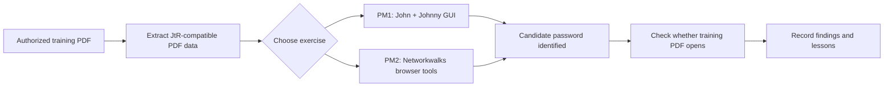

# Password Security Labs — Week 3

  
  
  
  

Two practical cybersecurity exercises exploring **password auditing and recovery for authorized, password-protected training PDFs**. I completed both Week 3 project modules: one using **John the Ripper with Johnny GUI** and the other using **Networkwalks' browser-based tools**.

This repository is a write-up of the learning process rather than a password-cracking toolkit. It includes the problem, workflow, verification approach, security observations, and a comparison of the tools.

> **Evidence transparency:** Both modules are marked complete based on my reported lab completion. The source materials available when this repository was prepared were the assignment guides and training PDFs, **not my execution screenshots or terminal logs**. Detailed timings, screenshots and the specific recovered password are intentionally not asserted or published.

## The challenge

The training provided password-protected PDF documents. The goal was to understand how an authorized password-recovery audit works, recover access to the assigned practice files, and learn why simple passwords are vulnerable to guessing attacks.

### Modules at a glance

| Module | Platform / tools | Method | Completion |
| --- | --- | --- | --- |
| **W3-PM1** | Windows; John the Ripper + Johnny GUI | Extract a JtR-compatible representation of PDF encryption parameters, load it into Johnny, run the audit and validate access | Completed (author-reported) |
| **W3-PM2** | Browser; Networkwalks Hash Calculator + Password Cracker | Extract a PDF-specific audit string, evaluate it in the browser tool and validate access | Completed (author-reported) |

## How I approached the work

The exercises followed the same high-level sequence but differed in where the work was processed and how the tools were operated. Importantly, the `$pdf$...` string is **not simply the plaintext password or a conventional stored password hash**: it is a tool-specific representation of data used to test candidate passwords against the PDF's protection mechanism.

## Project documentation

1. [Module 1 — John the Ripper and Johnny GUI](docs/01-jtr-johnny.md) — setup, audit process, validation.
2. [Module 2 — Networkwalks browser tools](docs/02-networkwalks-tools.md) — browser workflow, validation and data-sharing considerations.
3. [Tool comparison and security analysis](docs/03-comparison.md) — differences, risks and practical recommendations.
4. [Results and lessons learned](docs/04-results-and-reflection.md) — completion record, what the exercise demonstrates and evidence limitations.
5. [Publication checklist](docs/05-publication-checklist.md) — how to add screenshots safely and prepare the public repository.

## Lessons from both modules

- **A password-protected file is not automatically secure.** Protection depends partly on the strength and unpredictability of the password.
- **Recovery attempts are verification, not magic decryption.** Tools test password candidates against the file's encryption-related data.
- **Interface matters.** Johnny's GUI helps make the John workflow approachable; browser tools reduce setup work even further.
- **Data handling matters.** Uploading a real confidential document to a third-party extractor is risky; use only deliberately non-sensitive, authorized practice files with such services.
- **Good reporting needs evidence.** Private screenshots of key stages can be sanitized and included without exposing recovered passwords, hashes, or personal information.

## Environment and tools

- **W3-PM1:** Windows PC, [John the Ripper](https://www.openwall.com/john/), [Johnny GUI](https://openwall.info/wiki/john/johnny), a JtR-compatible PDF extraction step, assigned training PDF.
- **W3-PM2:** Web browser, [Networkwalks Hash Calculator](https://networkwalks.com/hash-calculator/), [Networkwalks Password Cracker](https://networkwalks.com/password-cracker/), assigned training PDF.

The exact John version, Windows build, timing, candidate count and attack mode used in my session were not supplied for this public write-up, so I have **not fabricated those details**.

## Scope and responsible use

All activity described here concerns **provided classroom/lab PDFs** or files for which the user has clear permission. No third-party accounts, systems or documents were targeted. Do not use these methods on files you do not own or have authorization to assess. Never publish recovered credentials, sensitive documents, raw password material, or any student's private data.

## References and credits

- [Networkwalks Academy — JTR lab](https://networkwalks.com/category/blog/ethical-hacking/) and [Networkwalks tools lab](https://networkwalks.com/password-cracking-with-networkwalks-tools-project-task-lab/)
- [John the Ripper — Openwall](https://www.openwall.com/john/)
- [John the Ripper documentation](https://www.openwall.com/john/doc/)
- [Johnny GUI — Openwall wiki](https://openwall.info/wiki/john/johnny)

**Attribution:** The training assignment and practice PDFs belong to their respective authors at Networkwalks Academy. This repository contains an independently written learning summary and links to official learning materials; it does not redistribute the protected PDFs, copyrighted task sheets, or screenshots taken from those sheets.
